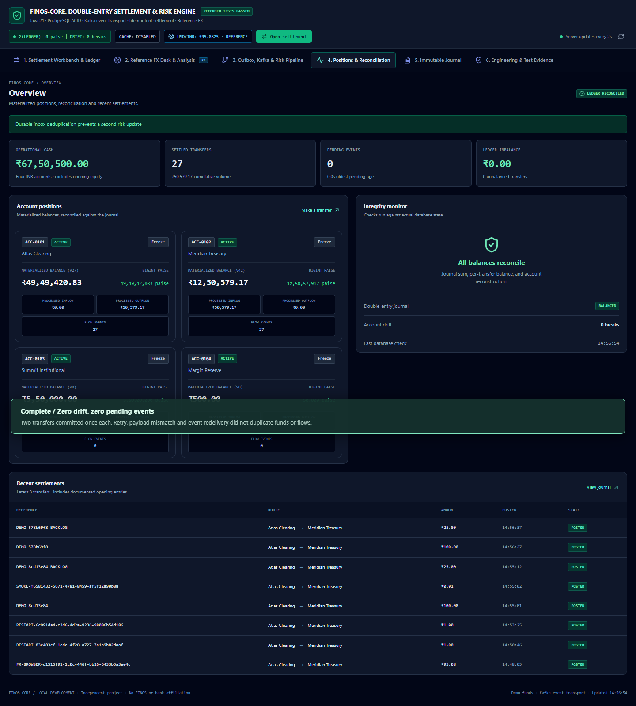
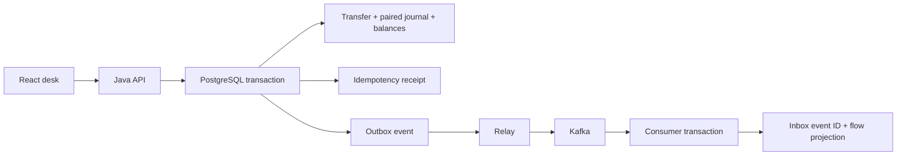

# FINOS-Core

A local settlement engineering project: a Java 21/Spring Boot 4 double-entry ledger, retry-safe API, Kafka event delivery, and a React operations desk. Uses fictional accounts and demo funds. Independent project; no FINOS or bank affiliation.

[](https://github.com/Ricoo05/finos-core/actions/workflows/verify.yml)

**Review in one minute:** inspect the [real demo recording](docs/demo/settlement-retry-recovery.webm), [five-minute walkthrough](DEMO.md), [financial integration tests](backend/src/test/java/dev/finoscore/LedgerIntegrationTest.java) and [verification status](FINAL_GITHUB_STATUS.md). The recording shows the local Java/PostgreSQL/Kafka system; it is not a publicly hosted banking service.



**Problem:** a client retries after a timeout, while a downstream event consumer is unavailable. The transfer must commit once, remain balanced, and eventually reach the flow projection without being counted twice.

## Run with Docker

For the built React/Nginx frontend, Java API, PostgreSQL, Kafka and authenticated Redis, follow [DOCKER.md](DOCKER.md). Only the frontend is exposed on loopback port 5173. Named volumes retain ledger and event data.

## Run on Windows x64

Requires Windows 10/11, PowerShell 7.2+, internet for the first setup, and approximately 4 GB of available disk space. The setup downloads pinned Java 21, Maven, PostgreSQL 16, Kafka, and Node archives and checks their SHA-256 hashes. Existing valid local runtime paths are reused. Nothing is installed as a Windows service or added to the global PATH.

From this directory, in PowerShell 7:

```powershell
./Setup-FINOS.ps1
./Start-FINOS.ps1
```

Open http://127.0.0.1:5173/ . To stop this project's recorded processes while preserving all data:

```powershell
./Stop-FINOS.ps1
```

`Setup` installs dependencies and builds the app. `Start` checks readiness before opening the browser. Re-running `Start` reuses this project's processes; it refuses occupied ports belonging to untracked processes. `Stop -AppOnly` leaves PostgreSQL/Kafka running for an app rebuild. Check `.local/*.log` if startup fails.

The native Windows demo retains Kafka logs without time-based expiry to avoid mapped-index rename failures during cleanup. These logs grow with demo use; this is a local development setting. Linux CI uses the container's normal retention policy. A broker restart may take up to a minute to rejoin the consumer group; committed outbox events remain durable during that interval.

If PostgreSQL reports a missing `VCRUNTIME`/`MSVCP` DLL, install Microsoft's supported x64 Visual C++ runtime, then rerun setup. This machine already runs PostgreSQL successfully. Runtime/data/credentials live in `.local` and are excluded from Git. Keep `.local/runtime.json` private. Stop the project before moving its data directory; rerun setup after changing runtime paths.

## Verify

```powershell
./Test-FINOS.ps1 -BrowserChannel msedge -LiveFx
```

This runs all 13 backend integration tests against the separate `finos_test` database, the HTTP smoke check, eight browser checks, and a production frontend build. Browser checks cover the workbench, responsive views, transfers/retries, freezing, backlog recovery, reconnect, FX quoting/settlement and the scenario/archive views. `-LiveFx` additionally checks the actual external provider and a server-issued quote; omit it when offline. Without `-BrowserChannel`, Playwright downloads its own Chromium. `-SkipBrowser` runs the other checks only.

Tests post small amounts of demo funds and leave an auditable history. Backend fixtures return their temporary balances after each test. Test and demo databases remain separate. Do not run two integration suites concurrently against the same test database.

`public/verification.json` contains the last recorded local result, displayed in Engineering. Detailed reports are in `backend/target/surefire-reports`, `.local/integration-tests.log`, `test-results`, and `playwright-report`. This is dated evidence, not an always-green monitor.

## How correctness works



- Amounts enter as integer minor-unit strings. Java uses `long`; the database uses `BIGINT`; the UI uses `BigInt` for money. FX conversion uses `BigDecimal` and HALF_EVEN rounding to INR paise.
- A transfer acquires account locks in UUID order, checks account status and funds, and writes both journal legs, balances, durable receipt and outbox in one database transaction.
- Deferred PostgreSQL constraints enforce the two journal legs, zero sum, correct source/destination amounts, and account-to-journal reconstruction. History cannot be updated or deleted by the application role.
- The idempotency key binds to a canonical SHA-256 request hash. Same key/request returns the stored receipt; a changed request returns 422. A failed transaction rolls back the key claim.
- The relay publishes with broker acknowledgement before marking an outbox event processed. A crash between those steps can redeliver. The consumer inserts its inbox ID and updates both account flow projections in one transaction. A duplicate ID changes neither projection.
- Malformed Kafka messages receive bounded retries, then are published to a dead-letter topic and recorded for inspection. The Kafka integration test exercises this path.
- Redis caches receipts after commit. A real-Redis integration test verifies cache hits, TTL, tamper rejection, eviction and durable repopulation. The native Windows path leaves Redis disabled; the full Docker stack enables authenticated Redis and tests outage/recovery.

## Live data and analysis

The backend fetches [ExchangeRate-API's open endpoint](https://www.exchangerate-api.com/docs/free), caches snapshots in PostgreSQL, and exposes provider timestamps and age. It refreshes at most hourly; the provider updates daily. USD/EUR/GBP inputs convert into the INR ledger using a server-issued quote valid for 120 seconds. Snapshots older than 48 hours cannot issue new FX quotes; INR transfers remain available.

The dashboard streams refresh notifications through SSE every two seconds, with polling fallback. Market analysis combines actual settled volume and consumed flow projections with an explicitly hypothetical USD/INR translation scenario. It does not present the scenario as a VaR model or a tradable price feed. Rate attribution appears in the desk.

## Useful endpoints

- `POST /api/transfers` — `Idempotency-Key` header; source/destination UUIDs, `amountMinor` string, `currency`, `reference`, nullable `quoteId`.
- `GET /api/state`, `/api/reconciliation`, `/api/market` — current desk state and provenance.
- `POST /api/quotes` — `{ "currency": "USD", "amountMinor": "100" }`.
- `POST /api/accounts/{id}/status` — `{ "frozen": true }`.
- `POST /api/pipeline/pause` — `{ "paused": true }`.
- `POST /api/pipeline/replay/{eventId}` — demonstrate consumer deduplication using a committed outbox event.
- `GET /api/events` — SSE refresh stream; `/actuator/health` and `/actuator/prometheus` provide health and metrics.

Ports: frontend 5173, API 8080, PostgreSQL 55432, Kafka 19092/controller 19093. Loopback only. The Vite server proxies `/api` and `/actuator` to Java. `dist` is the frontend build; serving it elsewhere also requires that proxy.

## Repository and CI

`src/` contains the desk; `backend/src/` contains the services, migrations and integration tests; `tests/browser/` contains browser workflows; `scripts/` contains runtime helpers and the HTTP smoke test. [DEMO.md](DEMO.md) is a short interview walkthrough.

The GitHub Actions workflow in `.github/workflows/verify.yml` provisions isolated PostgreSQL and Kafka services, runs all backend tests, builds the app, and checks it in Chromium. It intentionally disables external FX retrieval so core CI does not depend on a third-party API. The [first GitHub Actions run](https://github.com/Ricoo05/finos-core/actions/runs/41197540154) passed on 31 October 2026, including the backend integration tests, frontend build, HTTP smoke check and Chromium browser tests. Local live-FX checks also passed.

For Linux/macOS, use Java 21, Maven, Node 24, PostgreSQL 16, and Kafka with the environment/database setup shown in that workflow. The portable PowerShell bootstrap is Windows x64 only.

## Scope and tradeoffs

Single-primary PostgreSQL and one Kafka broker keep failure semantics inspectable on a laptop. Account row locks serialize writes to hot accounts. Publishing occurs while the relay holds a batch transaction open; it favors a small understandable implementation over maximum throughput. The 32-request bulkhead and 16-connection pool bound contention; no throughput benchmark is claimed.

This local deployment has no user authentication, bank connection, broker high availability, multi-region failover, or production regulatory controls. Keep it local. API errors use structured problem details; the origin filter rejects external browser origins and non-local hostnames. These controls do not replace authentication for a public deployment.

The archived browser simulator is reachable at `/?mode=simulator` and explicitly labeled. Its original source, PDF and conversation are retained privately in ignored `reference/`; they are context rather than verification evidence. Review those files before any redistribution. The portfolio's strongest claim is demonstrable behavior under concurrency, retries and failure.

## Review and contribution

Project code is [MIT licensed](LICENSE). See [dependency/provenance notes](THIRD_PARTY_NOTICES.md), [security scope](SECURITY.md), [executed security review](SECURITY_REVIEW.md), [contribution checks](CONTRIBUTING.md), and [15 implementation questions and exercises](INTERVIEW_GUIDE.md).

The readiness reports distinguish native Windows, hosted integration tests and the full Docker stack. See [Docker setup and recovery checks](DOCKER.md). Spring Boot 4.0.9 replaces the vulnerable Spring 6 dependency line; the resolved Maven advisory scan has zero matches and no exceptions. This is dated evidence, not continuous security certification.
